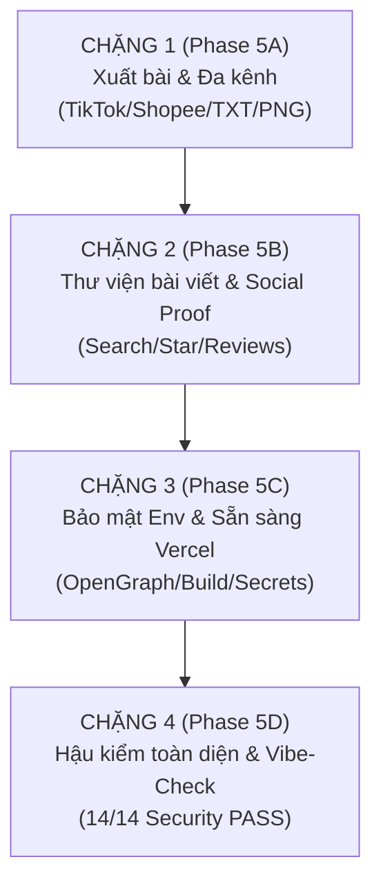

# 🗺️ CONTENT STUDIO — MASTER ROADMAP PHASE 5 (PRODUCTION & COMPETITION READY)

> **Mục tiêu:** Nâng tầm Content Studio thành sản phẩm SaaS thương mại hoàn chỉnh, đáp ứng mọi tiêu chuẩn chấm giải, sẵn sàng triển khai thực tế trên Vercel.

---

## 📌 TỔNG QUAN 4 CHẶNG TRIỂN KHAI

---

## 🚀 CHI TIẾT CHẶNG 1: XUẤT BÀI & TRẢI NGHIỆM ĐA KÊNH (PHASE 5A) — ✅ ĐÃ HOÀN THÀNH (100%)

### 🎯 Mục tiêu chặng 1:
Mở rộng Vùng 3 của Creative Studio thành trung tâm xem trước và xuất bản đa kênh (Facebook Ads, TikTok Script, Shopee SEO), kèm công cụ xuất file văn bản `.txt` trọn gói và tải ảnh banner quảng cáo 1-click.

### 📋 Phân bổ công việc chi tiết (3 Vertical Slices):

#### Task 5A.1 — Bộ Mô Phỏng Đa Kênh (Multi-Platform Simulator Tabs)
- **Vị trí:** Vùng 3 Workspace ([`src/components/workspace/FacebookMockup.tsx`](file:///d:/cpp/python/content-studio/src/components/workspace/FacebookMockup.tsx)).
- **Thiết kế:**
  - Thanh chuyển đổi tab trên đầu mockup: `[ 🌐 Facebook Ads ]`, `[ 🎵 TikTok Video ]`, `[ 🛍️ Shopee Feed ]`.
  - **Tab Facebook Ads:** Giữ nguyên giao diện bài viết Facebook Ads, mốc 125 ký tự vàng, nút *"Xem thêm"* bung mở và 5 hashtags.
  - **Tab TikTok Video:** Mô phỏng giao diện màn hình dọc điện thoại (9:16), avatar tròn với dấu cộng đỏ follow, icon tim đập/comment/share bên phải, đĩa nhạc quay góc dưới, text overlay hiển thị 3 giây hook đầu tiên và caption kèm hashtags.
  - **Tab Shopee Feed:** Mô phỏng thẻ sản phẩm thương mại điện tử, badge *"Mall / Yêu thích"*, tiêu đề chuẩn SEO, khung đánh giá 5 sao (★★★★★), số lượt bán và tóm tắt lợi ích FAB.
- **Tiêu chí hoàn thành (DoD):** Chuyển tab tức thì 0ms, không lag, đồng bộ văn bản từ Vùng 2 sang cả 3 nền tảng.

#### Task 5A.2 — Xuất Trọn Bộ Nội Dung Ra File Văn Bản (1-Click Export TXT)
- **Vị trí:** Toolbar trên đầu Vùng 2 (Editor) và Vùng 3 ([`src/components/workspace/WorkspaceContainer.tsx`](file:///d:/cpp/python/content-studio/src/components/workspace/WorkspaceContainer.tsx)).
- **Cơ chế kỹ thuật:** Dùng native Web `Blob` + `URL.createObjectURL` (Zero dependencies).
- **Cấu trúc file `.txt` xuất ra:**
  - Header thông tin sản phẩm và ngày tạo.
  - Phần 1: Bảng 3 Tiêu đề hấp dẫn (Headlines).
  - Phần 2: Góc 1 — Vấn đề & Giải pháp (PAS).
  - Phần 3: Góc 2 — Cảm xúc & Phong cách sống.
  - Phần 4: Góc 3 — Trực diện tính năng & Giá trị (FAB).
  - Phần 5: Danh sách 5 Hashtags đề xuất.
- **Tiêu chí hoàn thành (DoD):** Bấm nút tải về ngay lập tức, file UTF-8 chuẩn tiếng Việt có dấu, định dạng đẹp mắt dễ đọc.

#### Task 5A.3 — Tạo & Tải Ảnh Banner Quảng Cáo (Canvas PNG Generator)
- **Vị trí:** Nút "Tải ảnh quảng cáo (PNG)" dưới card mô phỏng.
- **Cơ chế kỹ thuật:** Sử dụng Native HTML5 Canvas 2D API (`document.createElement('canvas')`) vẽ banner tỷ lệ chuẩn 1200x630px:
  - Nền gradient cao cấp (Deep Navy to Emerald).
  - Tên thương hiệu + icon Sparkles nổi bật.
  - Tiêu đề quảng cáo sắc nét, độ tương phản cao.
  - Badge cam "Bán chạy #1" và nút CTA "Xem ngay".
  - Xuất ra file `.png` độ phân giải cao cho chủ shop đăng tải.
- **Tiêu chí hoàn thành (DoD):** Không dùng thư viện ngoài, tải ảnh trong < 100ms, hình ảnh sắc nét.

---

## 📦 CHI TIẾT CÁC CHẶNG TIẾP THEO

### CHẶNG 2: THƯ VIỆN LỊCH SỬ NÂNG CAO & SOCIAL PROOF (PHASE 5B) — ✅ HOÀN TẤT
- **5B.1 (Search History):** ✅ Thanh tìm kiếm thời gian thực (Live Search) theo tên sản phẩm / mô tả / nội dung caption trong `HistoryDrawer`.
- **5B.2 (Bookmark/Star):** ✅ Ghim (Star/Pin) bài viết yêu thích lên đầu danh sách, lưu bền vững qua `localStorage` (Zero DB schema migration).
- **5B.3 (Landing Social Proof):** ✅ Section `TestimonialsSection` với 3 đánh giá thực tế từ chủ shop Facebook/TikTok/Shopee.
- **5B.4 (Unlimited Free + Cooldown):** ✅ Gói Free tạo không giới hạn số bài với Cooldown 45s (AI Recharge Timer); Pro Turbo 0s tạo tức thì.
- **5B.5 (Transparent Pricing Matrix):** ✅ Cập nhật `PricingSection` minh bạch Free (45s cooldown) vs Pro Turbo (0s cooldown).

### CHẶNG 3: BẢO MẬT ENV, METADATA SEO & SẴN SÀNG VERCEL (PHASE 5C)
- **5C.1 (SEO Metadata):** Thẻ OpenGraph, Twitter Card, favicon SVG, canonical URL tại `layout.tsx`.
- **5C.2 (Env Matrix):** Chuẩn hóa file `.env.example` và danh sách biến môi trường Vercel.
- **5C.3 (Production Build):** Rà soát lệnh `npm run build` đảm bảo 0 lỗi biên dịch.

### CHẶNG 4: HẬU KIỂM TOÀN DIỆN & VIBE-CHECK BẢO MẬT (PHASE 5D)
- **5D.1 (Vibe-Check):** Quét an ninh 14/14 tiêu chí bảo mật (CSP, RLS, Headers).
- **5D.2 (End-to-End Test):** Chạy toàn bộ 11/11 tests và mô phỏng luồng người dùng thực tế.
